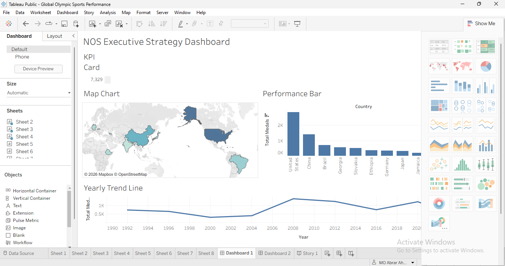
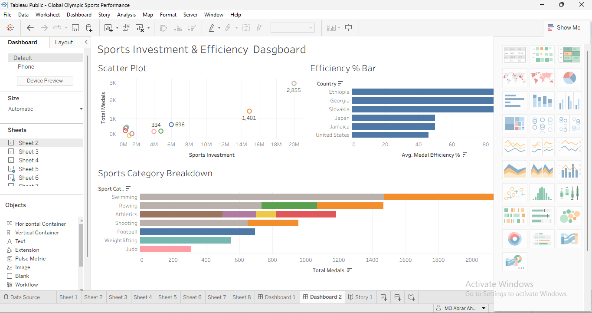
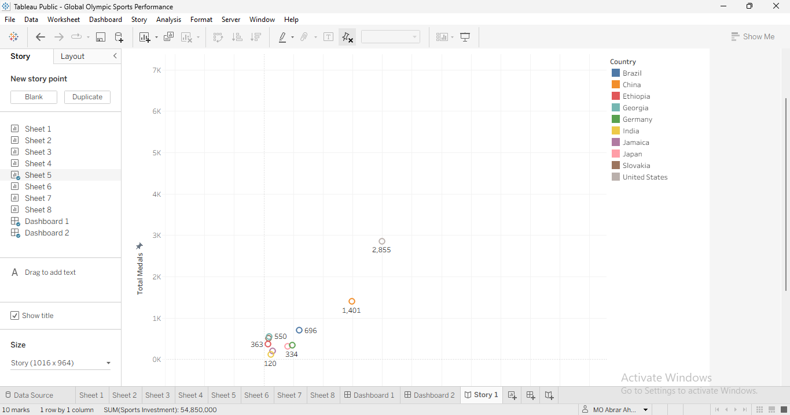
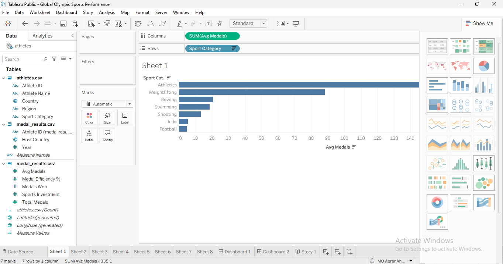
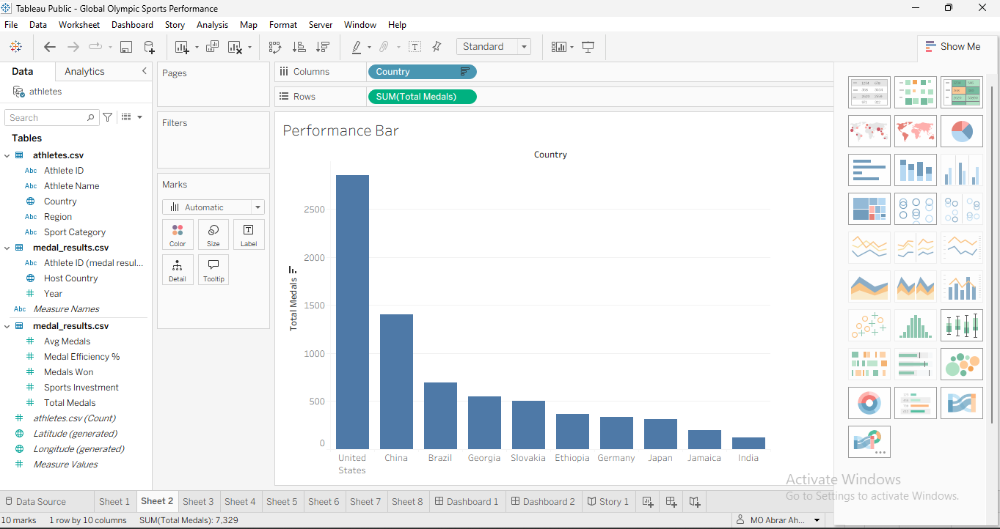
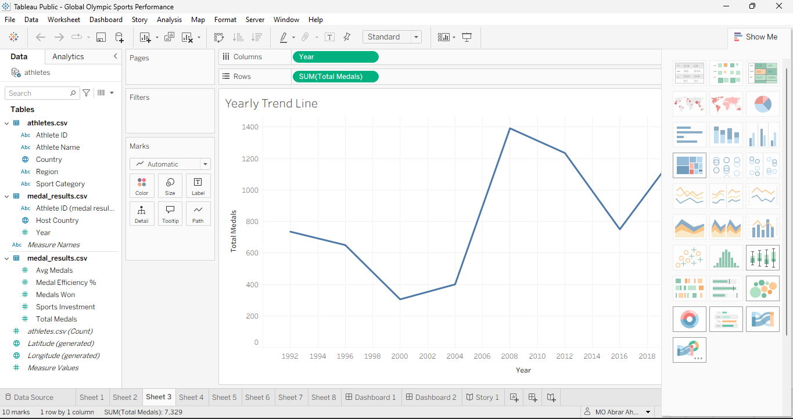
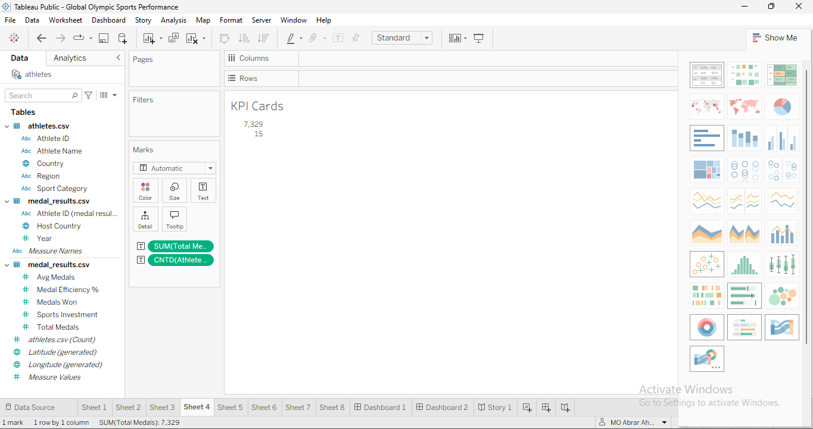
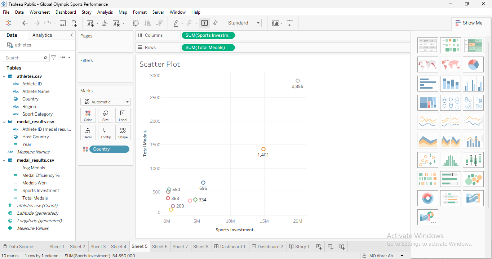
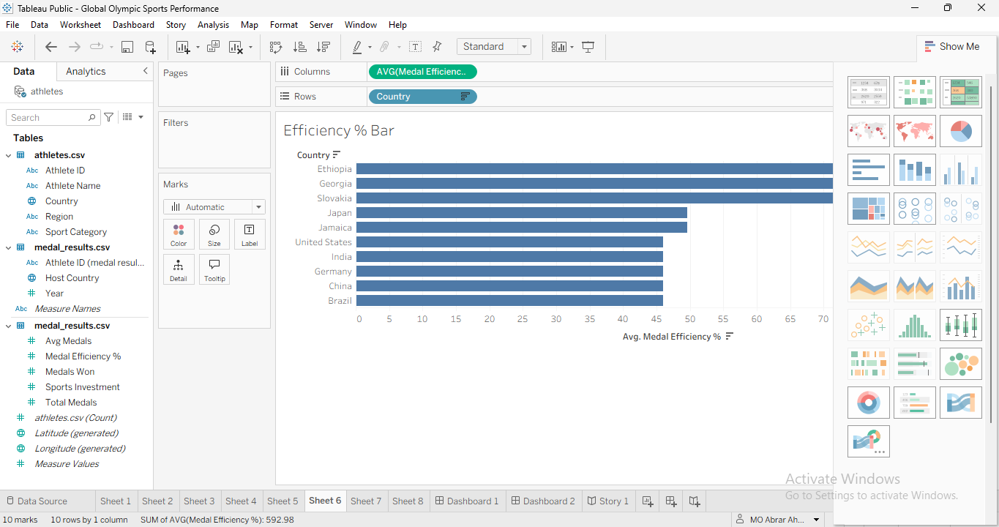
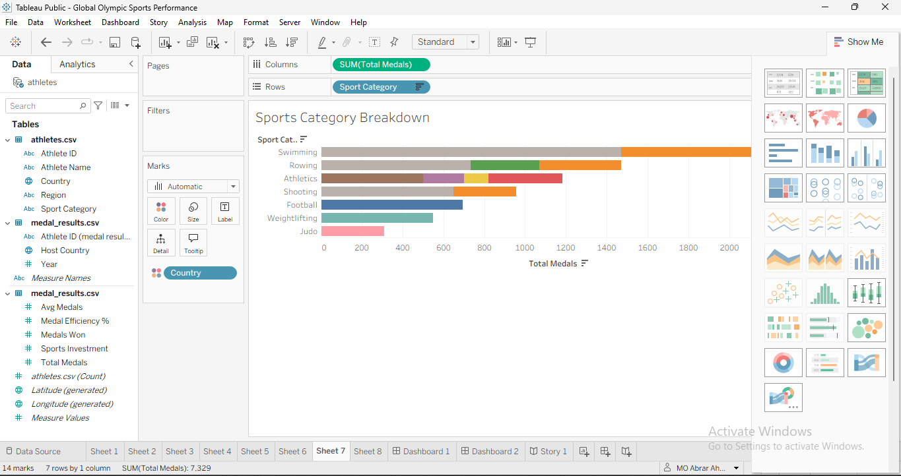

# Global Olympic Sports Performance Analysis (1992–2026)

An interactive analytics project that explores what drives Olympic success. Data is analysed and visualised in Tableau, then documented for end-to-end performance insights.

**Live Tableau Public**:  
[Click Here to View Live Story & Dashboards](https://public.tableau.com/app/profile/mo.abrar.ahmed/viz/GlobalOlympicSportsPerformance/Story1)

**Demo Video**: [ADD LINK HERE]  
**Author**: MO Abrar Ahmed  
**Contact**: en25cs3010572@medicaps.ac.in

---

## Overview

The Olympic Games are a global stage where nations compete to show sporting excellence, but the volume of historical data makes it hard to see what really contributes to success. This project analyses Olympic data from 1992 to 2026 to answer key questions such as:

- Which sports and countries win the most medals?
- How efficient is each country at turning athletes and investment into medals?
- How does performance differ by region?
- Do host countries gain an advantage, and how do medal totals change over time?

---

## Features

- **7 Visualisations**: Bar, horizontal bar, bubble, pie, donut, and line charts
- **2 Interactive Dashboards**: With filters (Year, Season, Region, Country) and click-to-filter actions
- **Tableau Story**: Interactive scenes that walk through the findings
- **Calculated Fields**: Such as Avg Medals per Athlete, Medal Efficiency %, Total Medals, and Host Flag

---

## Tech Stack

| Tool | Purpose |
| :--- | :--- |
| **Tableau Public** | Data connection, charts, dashboards, and story points |
| **Datasets (CSV)** | Relational Olympic Athletes & Performance Data |
| **Git + GitHub** | Version control and project documentation |

## Visualisations

| # | Sheet | Chart Type |
| :-: | :--- | :--- |
| 1 | Avg Medals per Athlete by Sport Category | Horizontal bar |
| 2 | Global Performance Metrics by Country | Bar |
| 3 | Global Sports Investment vs. Medal Performance | Bubble |
| 4 | Avg Medal Efficiency % by Region | Pie |
| 5 | Trend of Total Medals Awarded Over the Years | Line |
| 6 | Medal Totals Across Olympic Hosts | Bar |
| 7 | Regional Medal Efficiency and Distribution by Sport | Donut |

## Screenshots

### Dashboards

### Tableau Story

### Individual Sheets

## 📊 Tableau Dashboards & Visualizations

- **Live Tableau Public Story:** [Click Here to View Interactive Story](https://public.tableau.com/)
- **Key Dashboards Included:**
  - Executive Strategy Dashboard (KPIs, Global Map)
  - Historical Medal Performance Trends (1992 - 2026)
  - Country-wise Country Ranking & Investment Analysis

---

## 🔮 Future Enhancements
- Integration of live API endpoints for real-time sports data.
- User authentication for saved dashboard preferences.
- Containerization using Docker for seamless cloud deployment.